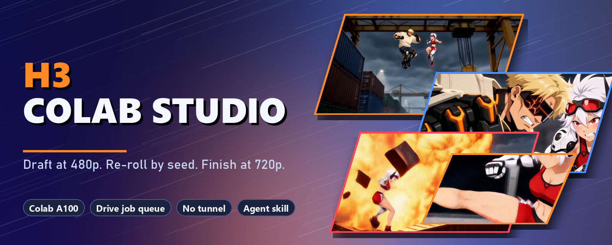
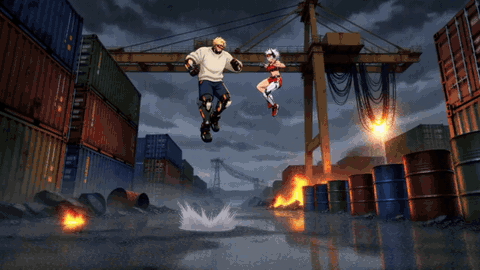
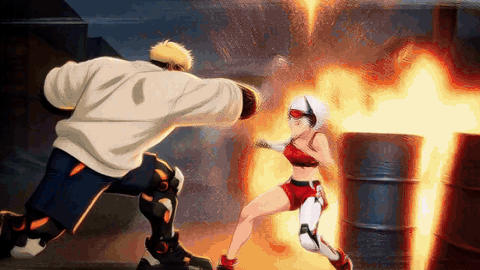
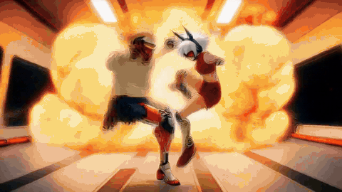
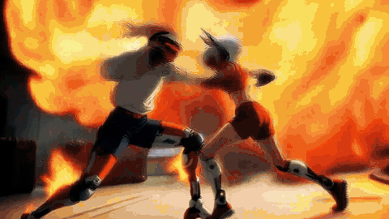
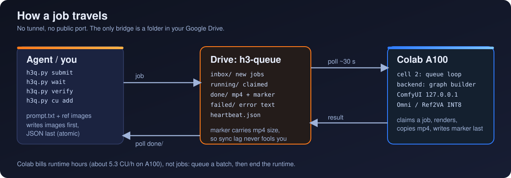
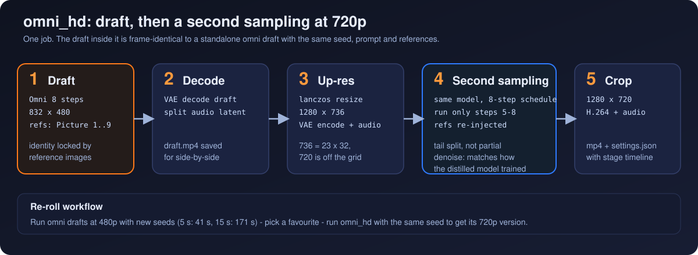

<p align="center">
  
</p>

<h1 align="center">h3-colab-studio</h1>

<p align="center">
  <b>Turn a Colab Pro A100 into a MiniMax H3 video render service your agent can call.</b><br>
  Draft at 480p, re-roll by seed, finish at 720p. Reference images only, no tunnel, one Google Drive folder as the API.
</p>

<p align="center">
  <b>English</b> · <a href="README.zh-TW.md">繁體中文</a>
</p>

<p align="center">
  <a href="LICENSE"></a>
  
  
  
  
  
</p>

---

## Showcase

All clips were rendered by this repo on one Colab A100, from two reference images, at 1280x720 / 24 fps with audio. GIFs below are 24 fps excerpts (the full 720p MP4s are in [`assets/videos`](assets/videos)); every clip links to its prompt.

<table>
  <tr>
    <td align="center" width="50%">
      <br>
      <b>5 s</b> · 3 shots · <a href="assets/videos/scrapyard-5s-720p.mp4">MP4</a> · <a href="benchmarks/prompts/b5-scrapyard-5s.txt">prompt</a><br>
      <sub>first 3.4 s shown · 355 s as rendered (cold; 133 s warm ¹) · about 0.18 CU ³</sub>
    </td>
    <td align="center" width="50%">
      <br>
      <b>10 s</b> · 5 shots · <a href="assets/videos/scrapyard-10s-720p.mp4">MP4</a> · <a href="benchmarks/prompts/b10-scrapyard-10s.txt">prompt</a><br>
      <sub>378 s · about 0.5 CU</sub>
    </td>
  </tr>
  <tr>
    <td align="center">
      <br>
      <b>15 s</b> · 6 shots · five-part prompt, 1,525 words · <a href="assets/videos/scrapyard-15s-720p.mp4">MP4</a> · <a href="benchmarks/prompts/b15-scrapyard-15s.txt">prompt</a><br>
      <sub>681 s · 0.88 CU</sub>
    </td>
    <td align="center">
      <br>
      <b>30 s combat, part 1</b> · <a href="assets/videos/combat-30s-720p.mp4">30 s MP4</a> · <a href="benchmarks/prompts/a1-combat-part1-15s.txt">prompt</a><br>
      <sub>h3-combat-impact example, 14 shots in 15 s · original references · 715 s (fresh VM)</sub>
    </td>
  </tr>
  <tr>
    <td align="center">
      <br>
      <b>30 s combat, part 2</b> · <a href="benchmarks/prompts/a2-combat-part2-15s.txt">prompt</a><br>
      <sub>569 s · motion energy 28.3 vs 28.1 for the original pipeline</sub>
    </td>
    <td align="center">
      <br>
      <b>Draft (left) vs second sampling (right)</b><br>
      <sub>same seed, same frames · <a href="docs/benchmarks.md#3-the-30-second-combat-test-two-15-s-segments">numbers</a></sub>
    </td>
  </tr>
</table>

The Kai and Vex reference images are not in this repo (the designs follow a public Seedance showcase, as in [h3-combat-impact](https://github.com/ayase0307/h3-combat-impact)). The 30 s combat clips were rendered with the original two images; the scrapyard clips with two images generated from the prompt's character text.

## Why this exists

- You pay for Colab Pro and get an A100, but **no API**. Agents cannot call a notebook.
- Colab's terms forbid serving from a runtime, so the usual "ngrok in a cell" trick risks the account.
- H3 wants long, structured prompts and reference images; a good result takes a few re-rolls before a final.

This repo is a notebook plus a small client: your agent drops a job into a Drive folder, the notebook renders it, the MP4 comes back to the same folder. **Nothing listens on the internet.**

## What you get

- **A job queue over Google Drive.** Submit with images first and JSON last, claim by rename, a completion marker that carries the MP4 size so Drive sync lag never fools you, crash recovery for jobs left in `running/`.
- **Reference-image modes only, built on FastH3 Omni (8-step) INT8.**
  - `omni` draft at 832x480: a 5 s draft in 41 s, 15 s in 171 s.
  - `omni_hd`: the same job plus a **second sampling at 1280x720** (details below).
  - `ref4`: Ref2VA + 4-step LoRA, about 1.5x faster drafts (not refinable).
- **Re-roll by seed.** A draft inside `omni_hd` is frame-identical to a standalone `omni` draft with the same seed, prompt and references, so you can pick a favourite draft and refine exactly that one.
- **Per-job accounting.** Each result carries a stage timeline (load, draft, up-res, refine, decode); `h3q cu` keeps the Colab compute-unit log.
- **A CLI and an agent skill** (`skills/h3-colab-studio`) so Claude Code or any SKILL.md-aware agent can submit, wait, verify and report.
- **A Chinese (zh-TW) notebook UI** for manual use, same engine.

<p align="center">
  
</p>

## Draft first, then a second sampling at 720p

<p align="center">
  
</p>

The second pass is the same distilled model run on only the tail of its own 8-step schedule, over the up-scaled draft, with the references injected again. A tail split matches how the distilled model was trained better than a partial-denoise schedule would.

<p align="center">
  <br>
  <sub>Left: the 480p draft stretched to 720p. Right: after the second sampling. Same frame.</sub>
</p>

## Measured on a Colab A100 (40 GB)

Session 1: 7 renders, **7.03 compute units** from a fresh VM (376.67 to 369.64), about 4.8 CU/hour averaged. Session 2 (the re-run with the original references): 2 renders, 2.21 CU. Full tables, methods and caveats: [`docs/benchmarks.md`](docs/benchmarks.md).

| Clip | Draft only (`omni`) | `omni_hd` (draft + 720p) | Compute units (`omni_hd`) |
|---|---:|---:|---:|
| 5 s | 41 s ¹ | 133 s ¹ (355 s cold ²) | 0.18 ³ |
| 10 s | about 115 s ⁴ | 378 s | 0.5 ³ |
| 15 s | 171 s ¹ | 656-681 s | 0.88 ⁵ |

<sub>¹ measured in an earlier single-reference session (one reference image, different prompts), not in the two-reference run below. ² the first job of the two-reference session, including model loading. ³ computed: 4.8 CU/h x seconds. ⁴ derived from the stage times of `omni_hd` jobs. ⁵ measured balance deltas (0.87-0.89 per job).</sub>

The second sampling is 54% of a 15 s job. `--refine-steps 3` cuts a 15 s job from 665 s to 582 s.

**30 s combat test** (two 15 s Ref2VA segments from h3-combat-impact; prompts byte-identical, original reference images):

| | This repo | Original showcase (local 8 GB GPU, 16-step `high`) |
|---|---:|---:|
| Part 1 motion energy / end-over-mid | 24.7 / 93% | 28.2 / 96% |
| Part 2 motion energy / end-over-mid | 28.3 / 81% | 28.1 / 93% |
| Quiet talking portraits, for scale | 1.4-2.1 | - |

**Reference images decide a lot.** My first run used two images I generated from the character text; the draft drew both fighters as Kai in one shot and the whole result looked weaker. Re-running the same prompts and seed with the original two images fixed that. The original pipeline is also a different recipe (16 steps, one pass, no distilled model), so expect a similar look, not the same shots. Side-by-side frames and details: [`docs/benchmarks.md`](docs/benchmarks.md#3-the-30-second-combat-test-two-15-s-segments).

<p align="center">
  <br>
  <sub>Same prompt. Rows 1 and 3: the original showcase. Rows 2 and 4: this repo, original reference images, 720p.</sub>
</p>

## Honest limits

- **Identity can slip in the second sampling.** In one 15 s clip (my generated references) the second fighter turned into a copy of the first for about a second; the draft was correct. `--refine-steps 3` fixed it in that clip ([evidence](docs/benchmarks.md#identity-loss-at-the-end-of-part-1-with-my-generated-references-and-the-refine-3-fix)), but that is one sample.
- **Weak or look-alike reference images make fighters merge.** With generated references the draft itself drew both fighters as Kai in a collision shot; the original images did not. Use references with clearly different silhouettes and colours.
- **Identity can also merge in the draft.** In the 5 s clip's last shot (a wide shot, both fighters small), both figures are drawn as Kai already in the 480p draft; the second sampling inherits it. The GIF above stops before that shot. A rough red-pixel check marks a few other low-Vex seconds in other drafts, but those may simply be shots without Vex; not verified.
- **The 30 s join is a cut, not a continuation.** Two independent 15 s renders: the seam check gives a WARN (64% of the surrounding motion) with the original references, a FAIL (24%) with my generated ones.
- **Long prompts did not hurt, and did not clearly help.** Four prompts up to 1,525 words and 8,986 characters rendered in full (no truncation in ComfyUI's tokenizer); the hosted API's 7,000-character cap is why they are local-only. One seed per cell, so inconclusive.
- Every new Colab VM needs one **Google Drive authorization click by a human** (an OAuth popup no agent can open), plus 6-7 minutes of install.
- Colab does not guarantee an A100; G4 (96 GB) and H100 were not measured.
- Weights are under the **MiniMax community license** (region limits apply); check it before you ship outputs.

## Quick start

**1. Notebook.** Open `notebook/MiniMax_H3_Studio.ipynb` in Colab (upload it, or save it to your Drive). Runtime type: **A100 GPU**.
Run cell ① (leave both download boxes ticked) - about 6-7 minutes on a fresh VM. Run cell ②, click the Drive authorization dialog. If cell ② stops with `mount failed`, run it again.

**2. Client.** On the machine that syncs your Drive (Google Drive for desktop), with Python 3.9+ and ffmpeg:

```bash
python skills/h3-colab-studio/scripts/h3q.py status
python skills/h3-colab-studio/scripts/h3q.py submit shot01 --prompt-file prompt.txt --mode omni --size p480 --seconds 15 --seed 7 --ref kai.png --ref vex.png
python skills/h3-colab-studio/scripts/h3q.py wait shot01
python skills/h3-colab-studio/scripts/h3q.py verify shot01 --out results/
# love seed 7? render it at 720p with the identical prompt and references:
python skills/h3-colab-studio/scripts/h3q.py submit shot01-hd --prompt-file prompt.txt --mode omni_hd --seconds 15 --seed 7 --ref kai.png --ref vex.png
```

**3. Stop paying.** Delete the Colab runtime when the batch is done (it bills runtime hours, not jobs).

**Agent skill.** Copy the skill folder where your agent reads skills, for example for Claude Code:

```bash
cp -r skills/h3-colab-studio ~/.claude/skills/
```

It works well with [`h3-video-prompting`](https://github.com/ayase0307/h3-video-prompting) (what to write) and [`h3-combat-impact`](https://github.com/ayase0307/h3-combat-impact) (fights, impact frames, camera energy).

## Repo layout

```text
notebook/        MiniMax_H3_Studio.ipynb   the Colab notebook (built from src/)
src/             h3_backend.py, ui.html    ComfyUI graph builder, queue worker, zh-TW UI
tools/           build_notebook.py, make_gifs.py, make_banner.py, identity_probe.py
skills/          h3-colab-studio/          SKILL.md, scripts/h3q.py, references/
benchmarks/      prompts/, records/, collect.py, cu-log.jsonl, make_prompts.py
docs/            benchmarks.md, agent-protocol.md
tests/           run_all.py + 5 test scripts (graph wiring, queue worker, CLI)
assets/          banner, diagrams, GIFs (24 fps), stills, 720p MP4s
```

Rebuild the notebook after editing `src/`: `python tools/build_notebook.py`. Run the tests: `python tests/run_all.py`.

## Credits and license

- Code and docs: MIT. See [`LICENSE`](LICENSE).
- Models: [MiniMax H3](https://huggingface.co/MiniMaxAI/MiniMax-H3) and [FastH3 Omni](https://huggingface.co/FastVideo/FastH3-Omni-Comfy) under their own licenses; ComfyUI is pinned at commit `ce42de5f` (needed for FastH3 Omni's PDD support).
- The 30 s combat prompts and the measuring tools come from [h3-combat-impact](https://github.com/ayase0307/h3-combat-impact); the five-part prompt format from [h3-video-prompting](https://github.com/ayase0307/h3-video-prompting). The Seedance 2.5 example that inspired the high-motion prompts is a public showcase, rewritten here for H3.
