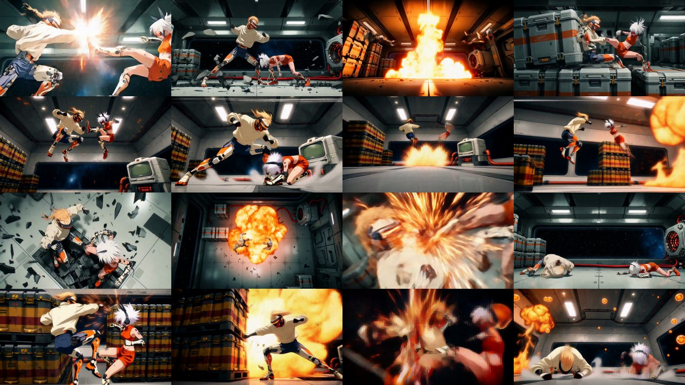
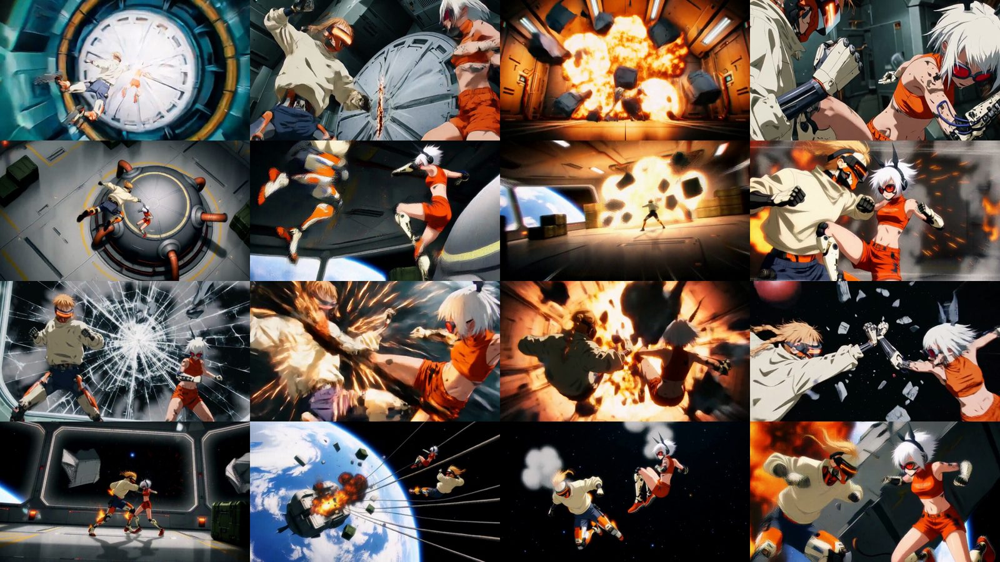
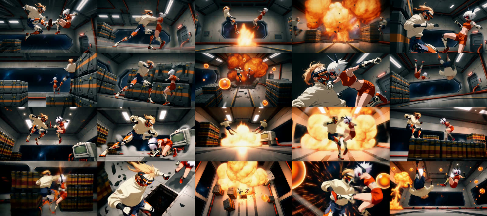
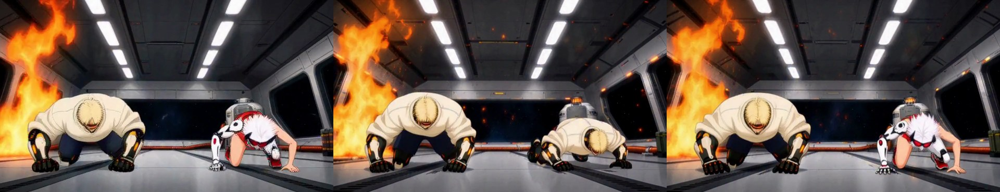
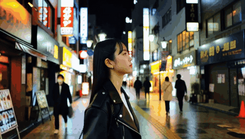
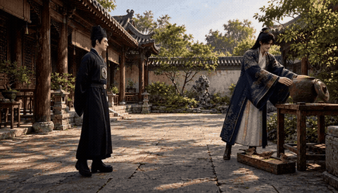

# Benchmarks and test record

Everything below was measured on 2026-10-22 on one Colab Pro A100 40 GB VM (the `ayase` runs in section 3 were on 2026-10-23), ComfyUI `ce42de5f`, INT8 FastH3 Omni + INT8 text encoder, 24 fps, reference images only (two characters). Raw per-job JSON is in [`benchmarks/records/`](../benchmarks/records), prompts in [`benchmarks/prompts/`](../benchmarks/prompts), the compute-unit log in [`benchmarks/cu-log.jsonl`](../benchmarks/cu-log.jsonl) and [`benchmarks/cu-log-4.jsonl`](../benchmarks/cu-log-4.jsonl) (session 4) and [`benchmarks/cu-log-5.jsonl`](../benchmarks/cu-log-5.jsonl) (session 5) and [`benchmarks/cu-log-6.jsonl`](../benchmarks/cu-log-6.jsonl) (session 6) and [`benchmarks/cu-log-7.jsonl`](../benchmarks/cu-log-7.jsonl) (session 7, the `ayase` run; only its last line is kept there) and [`benchmarks/cu-log-8.jsonl`](../benchmarks/cu-log-8.jsonl) (sessions 8 and 9, the `ayase` 10 s and tiled 15 s runs; only their balance lines are kept there).

Read the numbers with these caveats: one seed per cell, one pair of characters, motion and identity scored by simple scripts plus my own eyes. The first job after any model change includes 1-3 minutes of model loading; that is labelled "cold" where it applies.

## 1. Setup and the sessions in numbers

| Item | Value |
|---|---|
| GPU | Colab A100 40 GB (about 39.5 GiB visible), 83.5 GB system RAM |
| Fresh-VM install (cell 1, 62 GB of weights) | about 6-7 minutes |
| Colab compute units, session 1 | 376.67 -> 369.64 = **7.03 CU** in about 88 minutes (includes install, waiting, 7 renders) |
| Colab compute units, session 2 (re-run with the original references) | 369.64 -> 367.43 = **2.21 CU** in about 31 minutes (fresh VM install, 2 renders); log in `benchmarks/cu-log-2.jsonl` |
| Colab compute units, session 3 (non-distilled control `r1`) | 367.43 -> 363.9 = about **3.5 CU** in about 43 minutes (fresh VM install about 5 min, one 30 min render); balance read from the Resources panel, not logged in `cu-log` |
| Colab compute units, session 4 (non-distilled draft + second sampling `r2`) | 363.52 -> 360.87 = **2.65 CU** in about 27 minutes after install (one 23.5 min render); log in `benchmarks/cu-log-4.jsonl` |
| Colab compute units, session 5 (4-step turbo single pass `r3`) | 360.87 -> 359.54 = **1.33 CU** in about 9.9 min after install (one 8.2 min render); log in `benchmarks/cu-log-5.jsonl`. That is about 8 CU/h, above the panel's 5.3, so treat this single coarse reading with care |
| Colab compute units, session 6 (4-step turbo + SigmaShift 12/3 `r4`) | 359.03 -> 358.14 = **0.89 CU** in about 10.7 min after install (one 8.5 min render); log in `benchmarks/cu-log-6.jsonl`. That is about 5 CU/h, close to the panel's 5.3 |
| Colab compute units, session 7 (`ayase` 5 s smoke `s1` + failed 15 s `r5`) | 358.14 -> 353.81 = **4.33 CU** in about 44 min of runtime including install, about 5.9 CU/h by this reading, above the panel's 5.3. The 358.14 start is the previous session's end reading (no reading was taken at this session's start); log in `benchmarks/cu-log-7.jsonl` |
| Colab compute units, session 8 (`ayase` 10 s untiled `r6`) | 353.37 -> 346.74 = **6.63 CU** after install, up to the last panel reading before the runtime was deleted. The 353.81 -> 353.37 change happened before the after-install reading (install and setup) and is not counted. The session ran about 1 h 17 min and included a stuck reload attempt (about 7 min) that was abandoned by deleting the runtime; log in `benchmarks/cu-log-8.jsonl` |
| Colab compute units, session 9 (`ayase` 15 s tiled `r8`, fresh runtime) | 344.93 -> 341.84 = **3.09 CU** in about 34 min after install. The 346.74 -> 344.93 change (1.81 CU) happened between the two sessions (new VM install and setup) and is not attributed to a run; log in `benchmarks/cu-log-8.jsonl` |
| Average burn | 4.8 CU/h measured, the Colab panel states 5.3 CU/h |
| Per-job CU | 5 s about 0.18, 10 s about 0.5, 15 s about 0.88 (measured 0.87-0.89 for each 15 s job) |

The compute-unit balance is only shown in Colab's Resources panel and updates in coarse steps, so single-job deltas jump around (0.44 to 1.33 for similar jobs). Use the long-run slope, not one reading. Colab bills runtime hours, not jobs: batching is what saves units.

## 2. Draft and second-sampling timings (A100 40 GB, warm unless noted)

Draft = Omni 8 steps at 832x480. `omni_hd` = draft + second sampling (last 4 of 8 steps) at 1280x736, cropped to 1280x720.

| Clip | Draft only (`omni`) | Draft only (`ref4`) | `omni_hd` total | of which second sampling |
|---|---:|---:|---:|---:|
| 5 s | 41 s ¹ | 27 s ¹ | 133 s ¹ warm, 355 s cold ² | 54 s ¹ |
| 10 s | about 115 s ³ | 57 s ¹ | 378 s | 180 s |
| 15 s | 171 s ¹ | not run | 656-681 s | 354-361 s |

¹ measured in an earlier single-reference session (one reference image, different prompts); ² the first job of this session, including model loading; ³ derived from the stage times of the `omni_hd` jobs. The per-job CU figures: 0.88 is measured (0.87-0.89 for each 15 s job), the 5 s and 10 s values are computed as 4.8 CU/h x seconds.

Where the time goes in a 15 s `omni_hd` job (job `s6`, 665 s):

| Stage | Seconds | Share |
|---|---:|---:|
| Conditioning + draft sampling | 171 | 26% |
| Draft decode + save | 17 | 3% |
| Up-res (resize, VAE encode, second conditioning) | 75 | 11% |
| **Second sampling** | **358** | **54%** |
| Final decode + audio + mux | 44 | 7% |

`--refine-steps 3` instead of 4 cut the second sampling from 358 s to 269 s (job `s11`, total 582 s).

## 3. The 30-second combat test (two 15 s segments)

Prompts: [`anime-ref2va-part1/part2`](../benchmarks/prompts) from [h3-combat-impact](https://github.com/ayase0307/h3-combat-impact), **byte-identical to the originals** (checked against the `settings.json` that was sent to the model). Seed 21 for every run here. Motion metric is the combat skill's `measure_motion.py` (mean frame-difference energy; "end / mid" = last 2 s over the middle, pass at 60% or more).

I ran it twice, because the first result looked much weaker than the h3-combat-impact showcase:

| Run | Reference images | Part 1 energy / end-mid | Part 2 energy / end-mid | Joined 30 s | Seam check |
|---|---|---:|---:|---:|---|
| h3-combat-impact showcase | the original two images | 28.2 / 96% | 28.1 / 93% | - | - |
| **This repo, original reference images** (`o1`, `o2`, refine 3) | the original two images | 24.7 / 93% | 28.3 / 81% | 26.5 / 88% | WARN, 64% |
| This repo, my first run (`s6`, `s7`) | two images I generated from the text | 25.6 / 85% | 26.0 / 75% | 25.9 / 77% | FAIL, 24% |
| Same, part 1 with refine 3 (`s11`) | generated | 25.1 / 85% | - | - | - |
| Earlier Tomie talking portraits (5-15 s), for scale | one generated image | 1.4-2.1 | | | |




Timings with the original references on a fresh VM: part 1 715 s (includes model loading), part 2 569 s.

### Why the first run looked so different, and what is still different

1. **Prompts: identical.** Not the cause.
2. **Reference images were the largest factor.** With the two images I had generated from the text, the 480p *draft* drew both fighters as Kai in the shot at about 4.7-5.4 s (the two fighters colliding through the fire wall), and the second sampling inherited it. With the original images, the same seed and prompt keeps Kai (blond braid, orange visor) and Vex (white spiky hair, orange outfit) distinct in that shot and in the last frame (checked by eye at 4.7, 5.0, 5.4 and 14.78 s). The set, camera ideas (top-down hangar, the window onto Earth, cables) also match the showcase far more closely.
3. **The showcase was not rendered by the same pipeline, and that pipeline is not the official H3 base either.** Home-machine inspection (read-only) shows the showcase pipeline is FreeVideo (FlashML-org/FreeVideo, Apache-2.0), a ComfyUI-based local app. Correction: an earlier note here and in chat called its model "the official H3 base". It is not. FreeVideo's README says it is built on OpenVDN's 8-step **VDN-H3** model (Video DeltaNet: a linear-attention branch plus two small LoRA adapters on top of MiniMax H3; arXiv 2609.20744). The `models/vdn/h3-base` path in the job record is VDN's own folder name. So the showcase comes from a distilled/accelerated model family too, not from a plain non-distilled H3. What the saved job record shows (unchanged): quality level `high` = 16 steps, one pass, EasyCache-AV, SageAttention2, nvfp4_awq text encoder, no LoRA listed, 1280x704. Its other levels: `light` = 8 first-pass steps + 3 refine steps (half-size first pass, learned latent up-scale), `medium` = the same with a larger first pass, `max` = 20 steps (the two 15 s anime jobs on that machine were first run at `light`, 960x544). Not confirmed: whether the 16 `high` steps run on the VDN weights as such (I did not read FreeVideo's engine code). This repo runs FastH3 Omni (8-step distilled) then a short second sampling, so the recipes differ and cannot be expected to match shot for shot.
4. **What this does not explain:** how much of the remaining difference is the model, the step count or other settings (for example a LoRA). The home machine has combat, camera-motion and speed LoRAs installed, but the saved job specs list none for these clips, so I cannot say they were used. The control run in the next section (non-distilled Ref2VA, same references) rules out one explanation: it did not close the motion gap.
5. **Smaller visible gap:** the showcase opens with a contact flash at 0.6 s; ours opens with the two fighters still airborne at that moment. Part 2's ending is weaker (81% vs 93%).
6. **A prompt/reference mismatch exists in the original too:** the prompt says Vex wears red, the original image shows orange; the results follow the image.

Seam check (`seam_check.py`) on the joined 30 s with the original references: **WARN**, the seam frame differs by 9.4 against a neighbourhood median of 14.7 (64%): a small hitch a viewer may notice. With my generated references it was a hard **FAIL** (3.4 vs 14.4, 24%). The two segments are independent generations with no hand-off frame, so a cut is expected either way.

Prompt linter (`validate_prompt.py`) on the shipped examples: 0 FAIL, but both exceed its 820-word budget (1,207 and 1,135 words), as do all of our long prompts.

### Control runs: non-distilled Ref2VA (r1 single pass, r2 draft + second sampling)

To test the "Omni gave up quality for speed" suspicion, part 1 was rendered once with the official non-distilled Ref2VA (Comfy-Org `minimax_h3_ref2va_pruned_int8_convrot`, INT8 text encoder, no LoRA, no sigma-shift node, `BasicGuider`, `res_multistep` + `simple`, **20 steps**, the official ComfyUI r2v template's defaults), one pass at **1280x704**, 15 s, the original references, the same prompt, seed 20261019 (the showcase seed). This used the `ref2va` mode (`h3q submit --mode ref2va`).

`r2` is the same prompt, references and seed with `ref2va_hd`: a Ref2VA 20-step draft at 832x480, decoded, resized to 1280x736 and re-encoded; the last 8 of the same 20 steps are then sampled again with the references injected, and the result is cropped to 1280x720. The 8-step tail is my own choice, not an official template value, and no other value was tried.

| Run | Motion energy | End/mid | Time | Notes |
|---|---:|---:|---:|---|
| Omni + second sampling (`o1`, original refs) | 24.7 | 93% | 715 s incl. model loading | busier, softer frames |
| **Official Ref2VA, 20 steps, one pass (`r1`)** | **18.6** | **100%** | **1,817 s cold** (sampling 1,670 s) | cleaner frames, steady identities |
| Official Ref2VA, 20-step draft + last 8 steps at 720p (`r2`) | 16.4 | 128% | 1,412 s cold (second sampling 729 s) | clean frames, two distinct fighters |
| Ref2VA + 4-step turbo LoRA, one pass at 1280x704 (`r3`, `--mode ref4 --size p720`) | 17.7 | 98% | 494 s cold (sampling 348 s) | rougher frames by eye (one sample) |
| Same as `r3` plus SigmaShift 12/3 (`r4`, `--mode ref4 --size p720 --shift`) | 17.7 | 98% | 511 s, fresh VM (sampling 354 s) | bit-identical to `r3` (same video and audio streams) |
| Showcase (FreeVideo `high`) | 28.2 | 96% | not measured | different model family (see above) |

- It fit an A100 40 GB at 1280x704 x 362 frames (no out-of-memory error). About 2.4 compute units for the render, computed as 4.8 CU/h x time; the whole session including install used about 3.5 (balance 367.43 to 363.9).
- Looking at the contact sheet (my reading of one sample, not a measurement): the two fighters and the set stay consistent across cuts, edges are cleaner, and the explosions are calmer. But the motion energy is about a quarter **lower** than Omni's. Removing the distillation made the picture tidier, not more dynamic, so the missing impact in our clip is probably not caused by Omni's speed-up alone.
- **`r2` stage split** (one run): conditioning and draft sampling 540 s (38%), draft decode 26 s, up-res 74 s (5%), second sampling 729 s (52%), final decode and mux 44 s. Output 1280x720, 15.08 s, audio -19.2 dB.
- **Motion:** overall 16.4 for `r2` against 18.6 for `r1`; end/mid 128% against 100%; longest lull 0.17 s against 0.12 s. The opening-section score (9.1) is the first-section window of `measure_motion.py`; the r1 and Omni runs have no matching opening figure recorded here, so it is listed but not compared.
- **By eye** (one sample): two distinct fighters, clean frames, identities steady to the end, like `r1`. About 22% shorter than `r1`, but both were cold runs and the output size differs (1280x720 against 1280x704), so the times are not like-for-like.
- **Reading:** motion energy is lower than `r1` and both are below Omni's 24.7. One seed and one refine setting cannot show whether second sampling helps or hurts motion. The stronger ending (128%) is a single observation. Neither run closed the gap to the showcase.
- **Not run:** other `--refine-steps` or `--steps` values for `ref2va_hd`, a second seed, and FreeVideo/VDN-H3 on the same references.
- **`r3` (`ref4`, single pass, 1280x704, same prompt, references and seed):** the 4-step turbo path, one sample, 494 s cold. Stage split from the job timeline: conditioning 92.0 s, sampling 348.0 s, final decode 35.2 s, mux and save 15.4 s. Output 1280x704, 15.08 s, 24 fps, audio -14.0 dB, 21.6 MB. The job record also lists `refine_steps` 4, but this path is single pass and has no refine stage. The `records/RESULTS.md` row puts conditioning and sampling together under "load+draft" (442 s), as `r1` does.
- **Motion:** overall 17.7 (opening 16.8, middle 17.8, last 2 s 17.5), end/mid 98%, longest lull 0.12 s, peak 35. That is close to `r1` (18.6) and above `r2` (16.4). Still one seed.
- **Time:** 494 s against 1,817 s for `r1` (about 3.7 times faster) and 1,412 s for `r2`, all cold runs on fresh VMs. The speed gain is real for these runs; it says nothing about a warm steady state.
- **By eye** (one sample, three stills): the frames are rougher than `r1` and `r2`, with shimmering, hatched texture and smearing on both fighters, plus heavy motion blur. The palette is darker and more cinematic, and the set reads as a corridor with a window rather than the cargo bay of `r1` and `r2`. The identities stay distinct (blond hair with orange visor against white spiky hair).
- **Reading:** a 4-step single pass ran much faster than `r1` at similar motion energy, but it looked noticeably rougher. One seed, one sample, and no other step counts were run, so this does not show how the turbo path behaves on other prompts or seeds.
- **`r4` (`ref4`, `p720`, `--shift`: the same run as `r3` with the explicit MiniMaxH3SigmaShift node, 12 and 3, after the 4-step LoRA):** 510.5 s on a fresh VM (conditioning 100.5, sampling 353.7, final decode 36.1, mux and save 16.2). Output 1280x704, 15.08 s, audio -14.0 dB, 21.6 MB. The graph embedded in the MP4 metadata contains the shift node (`r3`'s does not), so the node was in the pipeline.
- **Finding:** the video and audio streams of `r4` are bit-identical to `r3` (same stream MD5), and every motion figure matches (overall 17.68, end/mid 98%, longest lull 0.12 s, peak 35, motion_mean_ydif 17.628). With this model path the 12/3 shift therefore changed nothing. The most likely reason is that the pipeline already uses 12/3 by default, which I have not verified. So the shift does not explain why `r3` looks rougher than `r1` and `r2`.
- **Caveat:** one seed, and only shift 12/3 was tested. By eye the frames are still rougher than `r1` and `r2`, as in `r3`. Once Colab gave an L4 instead of an A100 and cell 1 refused to run; a later retry got an A100.



### Ayase-style mode (`ayase`): 5 s smoke test and a failed 15 s run

`ayase` is a stock-node approximation of the Ayase Studio recipe, not its code: Ref2VA pruned INT8 + HyperFlow 8-step standalone LoRA (strength 1.0) + MiniMaxH3SigmaShift 12/3, euler + simple, an 8-step draft at 960x544 (0.5 MP), a neural latent upscale x2 to 1920x1088 (LBH-123-AI node, pinned 40316cf0), then a 7-step second pass at denoise 0.22 with a new seed, the repair instruction appended to the prompt, and the first-pass audio restored. The second pass is untiled (full layout) for `s1`, `r5` and `r6`; `r8` used the tiled second pass (`--tiled`). The studio's own recipe is 0.4 MP to 1.0 MP tiled; I used 0.5 MP x2 because my home GPU has 8 GB. The output is not bit-identical to the studio's Python.

| Run | Result |
|---|---|
| `s1`: 5 s, seed 20261019, same prompt and references as `r1` to `r4` | **678.26 s cold**: conditioning 91.4, draft sampling 107.8, draft decode 6.9, hd conditioning 16.0, second sampling 403.0 (59%), final decode 19.5, mux and save 12.8 (these sum to 657 s; about 21 s of the total is not itemised). Output 1920x1088, 5.17 s, audio -16.8 dB |
| `r5`: 15 s, same seed | **Failed.** The local ComfyUI service stopped answering (read timeout after 30 s). The Colab panel showed GPU RAM 39.2 of 40.0 GB at that time, so GPU memory exhaustion at 1920x1088 x 362 frames is the likely cause. Not verified; no video was produced |
| `r6`: 10 s, same seed, untiled | **1,731.5 s cold**: conditioning 109.8, draft sampling 195.3, draft decode 8.7, hd conditioning 16.0, second sampling 1,311.5, final decode 39.1, mux and save 21.5 (about 30 s not itemised). Output 1920x1088, 10.12 s, audio -19.6 dB, 24.7 MB |
| `r8`: 15 s, same seed, `--tiled` | **1,891.8 s cold**: conditioning 105.9, draft sampling 300.3, draft decode 10.0, hd conditioning 16.0, second sampling 1,333.3, audio decode 2.0, final decode 58.3, mux and save 31.5 (about 35 s not itemised). Output 1920x1088, 15.08 s, audio -18.1 dB, 31.4 MB |

Motion for `s1` (one seed, 5 s clip, **not comparable with the 15 s numbers above**): overall 34.3, opening 27.9, middle 35.0, last 2 s 36.0, end/mid 103%, longest lull 0.04 s.

By eye (one sample, one frame checked, not quantified): at the same timestamp, the 960x544 draft shows the hatched, shimmering texture and smearing seen in `r3`, and the 1920x1088 final removes almost all of it, with cleaner edges. One frame at about 1.7 s shows both fighters looking like Kai, with the white-haired Vex missing. I have not checked whether the draft has that frame too.

Reading: in this one sample the second pass repaired the draft's texture artifacts, but its sampling took 403 s against 108 s for the draft (about 3.7 times). The untiled 15 s run (`r5`) did not finish, and it was not retried after the job-loop timeout fix (a0a734c), so it is not known whether tiling was needed. Untested so far: upscale 1.5, a tiled-versus-untiled comparison at the same length, other `second_steps` or `second_denoise` values, other seeds.

- **`r6` (10 s, untiled, `--mode ayase --seconds 10`):** the untiled second pass at 1920x1088 ran to the end on the A100 40 GB. Second sampling was 76% of the total. Motion: overall 47.0, opening 24.1, middle 50.0, last 2 s 45.1, end/mid 90%, longest lull 0.12 s; `measure_motion.py` flagged the opening as too still. One sample.
- **`r8` (15 s, `--tiled`):** the second pass used `MMH3SplitUpscale`: spatial tiles 960x544 (overlap 0.25, fade 0.5, seam denoise 0.7), temporal chunks of 243 frames (overlap 22), seam polish auto, colour match on. Second sampling was about 70% of the total. Motion: overall 33.8, opening 14.1, middle 34.2, last 2 s 38.8, end/mid 113%, longest lull 0.42 s; also flagged 'opening too still'.
- **By eye** (`r8`, one sample; one timestamp side by side plus a 10-frame contact sheet, stills kept outside this repo): the 960x544 draft shows hatched texture and smearing on clothing and hair. The 1920x1088 final removes most of it but looks softer and hazier, with a large bright haze patch in the upper-left of that frame. Whether the tile blend or the colour match causes the haze is not verified. Across the 10 contact-sheet frames the two fighters stay distinct (blond Kai with a visor, white-haired Vex), and the scene and explosions stay coherent.
- `r6` and `r8` share the prompt and seed but differ in length, so their motion scores are not directly comparable.

### Identity loss at the end of part 1 (with my generated references), and the refine-3 fix

Job `s6` (refine 4): in the last second Vex turns into a second Kai after the second sampling, although the draft was correct. A red-pixel probe (`tools/identity_probe.py`) flags exactly that second (red share 1.20% in the draft, 0.43% after). With `--refine-steps 3` (job `s11`) the probe flags nothing and the frame keeps Vex. One sample, so treat 3 as the safer default for two-character fights, not as proof.



## 4. High-motion prompts at 5, 10 and 15 s (technique from the Seedance 2.5 example, written for H3)

Written with `h3-video-prompting` (origin/main) five-part shots: every `[Shot N]` has Camera / Motion / Performance / Light / Sound, one camera move per shot, no appearance restatement. Scene: a rain-lashed scrapyard under a gantry crane. Seed 12 (B15 pair), all `omni_hd`.

| Job | Clip | Shots | Prompt chars / words (detailed_description words) | Total | Energy | End / mid | Identity probe |
|---|---|---:|---|---:|---:|---:|---|
| B5 | 5.2 s | 3 | 5,630 / 940 (620) | 355 s cold | 20.0 | 100% | refine ok; the draft already merges both fighters into Kai in the last wide shot (seen by eye, about 1.2 s) |
| B10 | 10.1 s | 5 | 7,145 / 1,200 (870) | 378 s | 20.5 | 131% | ok |
| B15 five-part | 15.1 s | 6 | 8,986 / 1,525 (1,192) | 681 s | 22.2 | 118% | ok |
| B15 one-line | 15.1 s | 6 | 4,608 / 762 (428) | 656 s | 22.4 | 90% | ok |

Shot-length note: B5's three shots (1.7-1.9 s) and B10's first and last (1.7-1.8 s) are below the skill's 2 s guideline on purpose, to keep the energy high; the linter accepts them once the last shot is under 30% of the clip.

The identity probe compares a draft with its refined clip, so it cannot see a fault that is already in the draft. A draft-only red-share check marks low-Vex seconds in A2 (0, 1, 3 s) and B15 (0, 11 s), but those may be shots without Vex; only B5's last shot was confirmed by eye.

## 5. Prompt-length unlock: what happened

The newest `h3-video-prompting` makes five-part shots a normal choice and lets the user release prompts above 700 words. I released all of them and checked what changes:

- **No truncation.** ComfyUI's MiniMax tokenizer is built on a Qwen3-VL tokenizer with `max_length=99999999`; it raises an error rather than silently cutting. All four long prompts (up to 8,986 characters, 1,525 words) rendered in full; later shots (the fist at the lens in Shot 6) appear.
- **The hard cap is the hosted API:** 7,000 characters. B10 (7,145), B15 (8,986) and combat part 1 (7,022) exceed it, so they are local-only.
- **Render time did not change** (second sampling dominates; prompt length barely touches it).
- **Quality: no measurable gain or loss.** Five-part B15 and the one-line B15 have the same energy (22.2 vs 22.4). The five-part opening is quieter (first 0.8 s energy 9.2 vs 22.8) but its ending is stronger (118% vs 90%). With one seed per cell this is inconclusive, not a verdict.

## 6. How the numbers were produced

```bash
python skills/h3-colab-studio/scripts/h3q.py submit s9-b15-fivepart --prompt-file benchmarks/prompts/b15-scrapyard-15s.txt --mode omni_hd --seconds 15 --seed 12 --ref kai.png --ref vex.png
python skills/h3-colab-studio/scripts/h3q.py wait s9-b15-fivepart
python skills/h3-colab-studio/scripts/h3q.py verify s9-b15-fivepart --out results/
python benchmarks/collect.py --queue <queue> --jobs s5-b5-smoke ... --out benchmarks/records
python tools/identity_probe.py results/job.draft.mp4 results/job.mp4
```

The reference images of Kai and Vex are not in the repo (they follow a public Seedance showcase, as in h3-combat-impact); generate your own from the `subject_definitions` text.

## 6b. A100 兩模式配置與實測（2026-10-24）

硬體：Colab **A100-SXM4-40GB**，分支 `fix/a100-quality`，約 **5.3 CU/小時**。第 ① 格（環境準備）約 4.5–5.3 分鐘。整批測試共用掉約 **3.1 CU**（334.44 → 331.34）。

| 路線 | 品質選項 | 輸出 | 模型 | 取樣 |
|---|---|---|---|---|
| **快速出片** | 極速 · Turbo 4 步（768p 調校） | 橫向 960×544，24 fps | INT8 主模型 + INT8 文字編碼器 + fp16 影片 VAE | euler / simple |
| **高清** | Omni · 參考圖生成（8 步） | 橫向・高解析度 1344×768，**單次直出**（不是 `omni_hd` 草稿＋精修） | INT8 主模型 + INT8 文字編碼器 + fp16 影片 VAE | euler / simple，cfg 1.0 |

<table>
  <tr>
    <td align="center" width="33%"><br><sub>快速出片 · 5 秒 · 960×544</sub></td>
    <td align="center" width="33%"><br><sub>高清 Omni · 5 秒 · 1344×768</sub></td>
    <td align="center" width="33%"><br><sub>高清 Omni · 10 秒 · 1344×768</sub></td>
  </tr>
</table>
<sub>GIF 為 480px、12 fps、取前段約 4 秒，畫質遠低於原始 MP4。</sub>

| 路線 | 長度 | 冷啟動（第一支） | 暖機後 | GPU RAM（Colab 面板） |
|---|---:|---:|---:|---:|
| 快速 · Turbo 4 步 960×544 | 5 秒 | 1 分 38 秒 | **31 秒** | 約 37–38 / 40 GB |
| 快速 · Turbo 4 步 960×544 | 10 秒 | – | 1 分 20 秒 | 約 36–38 / 40 GB |
| 快速 · Turbo 4 步 960×544 | 15 秒 | – | 2 分 25 秒 | 約 36–38 / 40 GB |
| 高清 · Omni 8 步 1344×768 | 5 秒 | 4 分 56 秒 | **3 分 28 秒** | 約 37.8 / 40 GB |
| 高清 · Omni 8 步 1344×768 | 10 秒 | – | 7 分 11 秒 | 約 36–38 / 40 GB |
| 高清 · Omni 8 步 1344×768 | 15 秒 | – | ❌ 失敗：約 10 分 37 秒後 Runtime died（GPU RAM 約 39.1 / 40 GB，推測 OOM） | – |
| 參考：Turbo 8 步 1344×768（純文字） | 5 秒 | 5 分 00 秒 | – | – |

<sub>GPU RAM 是任務剛結束時面板的讀數（含 PyTorch 快取），不是精確峰值。</sub>

注意事項：
- **高清 15 秒**在 40 GB 卡上會爆顯存：請改用 A100 80GB（可選「未量化」），或切成每段 ≤10 秒再接起來。
- A100 不支援 FP4，**不要選 NVFP4 文字編碼器**。

## 6c. Ultra-quality post-processing (branch `feat/ultra-quality`, 2026-10-24)

Tick `download_facerefine` and/or `download_seedvr2` in cell ①, then use 「極致畫質後製（生成後另跑）」 or the history 「後製」 button. Outputs: `video_face.mp4`, `video_1080p.mp4`, `video_face_1080p.mp4`.

<p align="center"><br><sub>HQ Omni 5 s → face refine (anime) → SeedVR2 3B 1890×1080 (first 5 s, scaled down)</sub></p>

| Job (A100 40 GB) | Time | Output |
|---|---:|---|
| HQ Omni 5 s generation | 328 s | 1344×768 |
| Face refine (anime) | 228 s | 1344×768 |
| Face refine + SeedVR2 3B INT8 1080p | 219 s + 462 s (UI 11m37s) | 1890×1080 |
| SeedVR2 7B FP16 1080p | not recorded | 1890×1080 |
| HQ Omni 10 s (573 s) + face + 1080p | face OK; **runtime died in the 1080p pass** | - |

On a 40 GB A100, keep the 1080p pass to clips of about 5 s, or use an 80 GB GPU.

## 6d. Multiple reference images

Click 「+ 新增參考圖」 to add up to 9 references; image N maps to `<Picture N>` in the prompt (numbering starts at 1, contiguous). Tested with two 反派擺爛指南 shots, 3 refs each, HQ Omni 1344×768, 10 s, about 2 CU for both:

<table><tr>
<td align="center" width="50%"><br><sub>C14 · 3 refs · 9m53s (cold)</sub></td>
<td align="center" width="50%"><br><sub>C06 · 3 refs · 8m10s</sub></td>
</tr></table>

## 7. Not measured

- A second seed for any cell; other character pairs; real-world (non-anime) subjects.
- G4 (96 GB) or H100; resolutions above 1280x736.
- ~~A non-distilled draft plus second sampling~~ (one run, `r2`); the FreeVideo/VDN-H3 model run on the same references; the Singularity community fine-tune.
- `ref2va_hd` with other refine-step or draft-step counts; a second seed for `r1` and `r2`.
- `ref4` at `p720` with another seed or step count, and a second sample of `r3` (one run only).
- Other `--shift` values, the HyperFlow 8-step LoRA, `MiniMaxH3TurboSampler`, and other LoRAs on the `ref4` path (`r4` used only 12/3 with the 4-step LoRA).
- `ayase` beyond `s1`, `r6` and `r8`: an untiled 15 s retry after the timeout fix (`r5` failed before it), a tiled-versus-untiled comparison at 10 s, upscale 1.5, other `second_steps` or `second_denoise` values, other seeds, whether the draft has the identity slip, and the haze patch in `r8`.
- Lip-sync and dialogue; only audio presence and level were checked.
- A human blind comparison of draft vs refined; the detail comparison is by eye.
